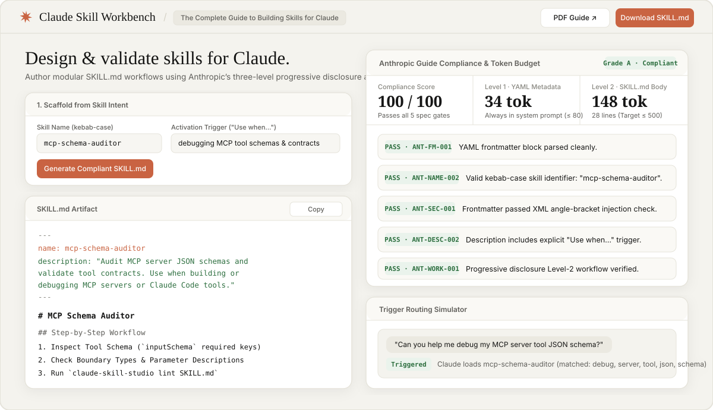

# 🧡 Claude Skill Studio (`claude-skill-studio`)

<p align="center">
  
</p>

<p align="center">
  <a href="https://newzwalker.github.io/claude-skill-studio/"></a>
  <a href="LICENSE"></a>
  <a href="https://www.python.org/"></a>
  <a href="https://resources.anthropic.com/hubfs/The-Complete-Guide-to-Building-Skill-for-Claude.pdf"></a>
</p>

**Interactive `SKILL.md` Builder, 3-Level Progressive Disclosure Token Profiler, Security Linter, and Trigger Confidence Simulator built directly from Anthropic's official guide (*The Complete Guide to Building Skills for Claude*).**

---

## 🎯 Why `claude-skill-studio`?

Anthropic's official guide (*The Complete Guide to Building Skills for Claude*) defines strict architectural rules for building reliable skills across **Claude.ai**, **Claude Code**, and the **Anthropic API**:
1. **3-Level Progressive Disclosure**:
   - **Level 1 (YAML Frontmatter)**: Always loaded in Claude's system prompt (`name` + `description`). Must stay compact (`<= 80 tokens` / `<= 300 chars`) to avoid context bloat.
   - **Level 2 (`SKILL.md` Body)**: Loaded only when triggered (`<= 500 lines`).
   - **Level 3 (Bundled Resources)**: `scripts/`, `references/`, and `assets/` loaded or executed on demand.
2. **Frontmatter Security**: No XML angle brackets (`<` or `>`) allowed in frontmatter to prevent system-prompt injection.
3. **Trigger Precision**: Descriptions must specify both **what the skill does** and **when to activate it** (`"Use when..."`), plus optional negative triggers (`"Do NOT use for..."`) to prevent over-triggering or under-triggering.

`claude-skill-studio` automates all of these rules via both a **Zero-Dependency Web Studio (`index.html`)** and a **CLI / CI Linter (`claude-skill-studio`)**.

---

## ✨ Rule Audit Matrix

| Rule ID | Category | What It Enforces (Anthropic Guide Spec) |
| :--- | :--- | :--- |
| `ANT-FM-001` | Structure | Valid YAML frontmatter delimited by `---` at line 1 |
| `ANT-NAME-002` | Naming | Strict `kebab-case` skill identifier (`^[a-z0-9]+(-[a-z0-9]+)*$`) |
| `ANT-SEC-001` | Security | Zero XML angle brackets (`<` or `>`) inside YAML frontmatter |
| `ANT-DESC-002` | Triggering | Explicit trigger clause (`"Use when..."`, `"Trigger on..."`) |
| `ANT-DESC-003` | Token Budget | Level-1 frontmatter token budget profiler (`<= 300 chars` ideal, `1024` max) |
| `ANT-PROG-001` | Disclosure | Level-2 body line/token budget check (`<= 500 lines`) |
| `ANT-LINK-001` | Resources | Verifies every linked `scripts/*` or `references/*` file exists on disk |

---

## 🚀 Quick Start (CLI & Python SDK)

### Installation

```bash
git clone https://github.com/newzwalker/claude-skill-studio.git
cd claude-skill-studio
pip install -e .
```

### Scaffold a New Anthropic-Compliant Skill

```bash
claude-skill-studio scaffold \
  --name mcp-schema-auditor \
  --what "Audit MCP server JSON schemas and validate tool input contracts" \
  --when "building, debugging, or testing MCP tool definitions" \
  --out ./my-skill/SKILL.md
```

### Lint Any `SKILL.md` or Skill Directory

```bash
claude-skill-studio lint ./my-skill/SKILL.md
```

```text
========================================================================
 Claude Skill Studio v0.3.0 | PASS (ANTHROPIC GUIDE COMPLIANT)
========================================================================
 Target           : my-skill/SKILL.md
 Skill Name       : mcp-schema-auditor
 Compliance Score : 100.0 / 100.0  [Grade: A]
 Level-1 Metadata : ~32 tokens (Always loaded in system prompt)
 Level-2 Body     : ~115 tokens (24 lines)
 Trigger Clause   : Yes | Negative Triggers: Yes
------------------------------------------------------------------------
 Rule Audit Breakdown:
  ✓ [ANT-NAME-001] (PASS): Valid kebab-case skill identifier: `mcp-schema-auditor`.
  ✓ [ANT-SEC-001] (PASS): Frontmatter passed XML angle-bracket injection check.
  ✓ [ANT-DESC-002] (PASS): Description contains explicit activation trigger phrasing ('Use when...').
  ✓ [ANT-DESC-003] (PASS): Level-1 description length is compact (162 chars).
  ✓ [ANT-PROG-001] (PASS): Progressive Disclosure Level-2 budget healthy (24 lines, ~115 tokens).
  ✓ [ANT-WORK-001] (PASS): Body includes structured workflow headings and executable examples/steps.
========================================================================
```

---

## 🧪 Run Deterministic Test Suite

```bash
python tests/test_linter.py
```

## 📄 License

MIT © [Newz Walker](https://github.com/newzwalker)
